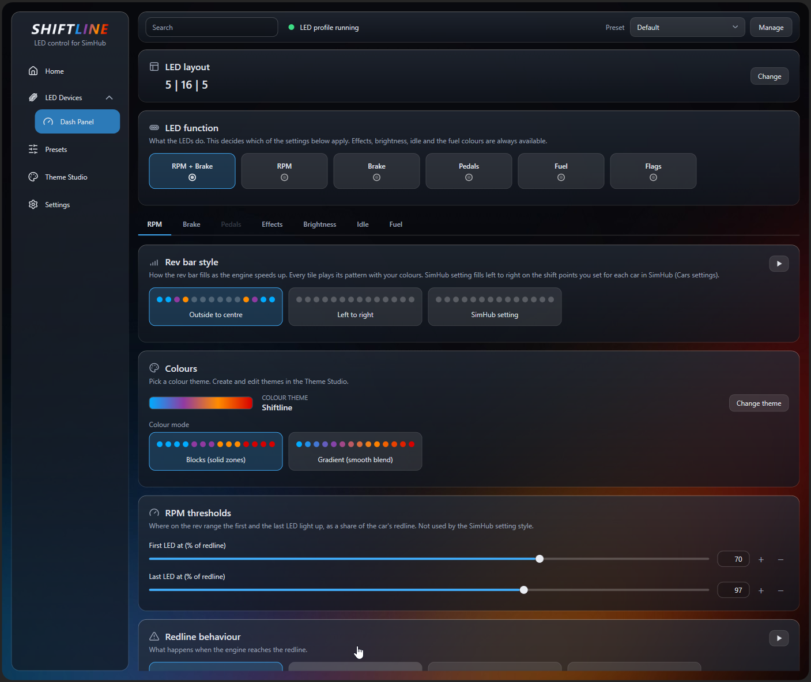

# Shiftline

Shiftline aims to be one free plugin for everything around SimHub: LED devices, on-screen overlays, and later dashboards and control devices.

- **LEDs:** rev lights, brake and pedal bars, fuel, flags and effects for any SimHub LED device, with presets per game and car.
- **Overlays:** a standings table for now, more are on the way.

> **Shiftline is still in beta.** The LED part has been tested by one person on one device (an Arduino with a WS2812B strip, 5 | 16 | 5 LEDs, SimHub 9.13.3, mainly iRacing). The overlays are new: the standings were tested in iRacing only, other games use SimHub's opponent data and are untested. Please report what you find.



## Features

- **RPM bar** with several styles (outside to centre, left to right, SimHub setting), colour themes, blocks or gradient, start and end points, redline behaviour and an optional flash at SimHub's shift point
- **Brake and throttle bars** with pedal presets (brake on the sides or the top, throttle in the centre and more), ABS and TC stay visible while braking
- **Effects** with their own switch and colours: flags, spotter, pit lane, pit limiter, low fuel, TC/ABS, DRS, ERS, turn indicators and more. One main switch turns them all off
- **LED functions:** RPM and brake, RPM only, brake only, throttle and brake, fuel gauge or flags
- **Fuel gauge** on the sides or the top, together with any function
- **Idle animations** (16 styles) while no game runs, and in the garage and menus
- **Presets:** a full set of settings per game and car, switched automatically, with import and export as plain JSON files
- **Theme Studio:** your own colour themes with 2 to 5 colours. The "Shiftline" theme is the default
- **Layout** for your strip: up to 8 LEDs per side and 32 on top
- **Hotkeys** for next and previous preset, brightness and night mode (map them in SimHub under Controls and events)
- **Night mode** switch (halves the brightness) and brightness for everything and for the idle animation
- **Backups, settings profiles, a system log and a test mode** (manual sliders or an automatic scenario loop) on the Settings page
- **Updates:** the plugin looks for a newer release on GitHub and can install it

Untested so far: ERS mode and the safety car delta (F1 games), the update installer.

### Overlays (new)

- **Standings:** position, class colour, places gained, car number, name, car make, licence and iRating with an estimated change (iRacing), gap and interval, last lap, tyres, pit stops and the live delta to the cars around you. Header with session, track, time left, SOF and clock; footer with your last, best and delta
- **Battle Bar:** you in the middle with the cars around you, or a ticker with the field like on TV (fixed or running), with gaps, trend arrows and a battle frame
- Every column can be switched and styled: number styles, name formats, decimals, backgrounds, fonts (Inter and Saira SemiCondensed built in), rounded or square corners, rows and size
- Classes on their own, grouped or mixed; animated position changes
- **Edit mode** to drag and size the overlays, also on a second monitor. They show only while the game is in front, and hide in replays and the garage unless you switch that on
- Other games (Assetto Corsa, Automobilista, rFactor and more) use SimHub's data. Columns a game does not provide are hidden
- More overlays are planned: relatives, track map, fuel calculator, pit helper, pedals, inputs graph and spotter

## Install

1. Download `Shiftline-Setup-<version>.exe` from the [latest release](https://github.com/rauwman/Shiftline/releases) and run it. It asks for the SimHub folder (the one with `SimHubWPF.exe`) and closes SimHub if it is running.
2. Start SimHub. Shiftline appears in the left menu.
3. Import the LED profile **Shiftline Loader** into your LED device, once. The installer puts it into `C:\Users\Public\Documents\Shiftline`.

Windows SmartScreen may warn about an unknown publisher because the installer is not signed. Choose "More info" and "Run anyway".
4. Select that profile and choose what the LEDs do under **Shiftline > LED Devices > Dash Panel**.

The loader profile contains no LED logic. It runs the script that the plugin delivers, so a plugin update updates the LEDs and you do not import anything again.

Without the installer, copy `Shiftline.Plugin.dll` from a release into the SimHub folder.

## Update and uninstall

- **Update:** the Home page shows a new version and can install it. Or run the new installer, it offers "Update or repair".
- **Uninstall:** run the installer again and choose "Uninstall", or use Windows' app list. You can keep or delete your settings and presets (`SimHub\PluginsData\Shiftline`). The imported LED profile has to be removed in SimHub.

## Known limits

- Tested with SimHub 9.13.3 on Windows with one Arduino strip. Please open an issue with your SimHub version, game and the system log (Shiftline > Settings) when something does not work.
- ERS mode and the safety car delta use SimHub property names found by research, not confirmed in a real F1 game.
- Overlays need the game in windowed or borderless mode.

## Build from source

Visual Studio, .NET Framework 4.8. Set the environment variable `SIMHUB_INSTALL_PATH` to your SimHub folder (with a trailing backslash). A Debug build copies the plugin straight into SimHub, a Release build ends up in `plugin\Shiftline\bin\Release`. Details: [`docs/BUILD.md`](docs/BUILD.md), release steps: [`docs/RELEASE.md`](docs/RELEASE.md).

Shiftline is developed with heavy use of an AI coding assistant (Claude by Anthropic). Design decisions, testing on real hardware and releases are done by the author.

| Path | Content |
|---|---|
| `plugin/Shiftline/` | The SimHub plugin (WPF). `Settings.cs`, `TestScenarios.cs` and `TabSettings.cs` are generated by `tools/gen.py` |
| `tools/Shiftline.plugin.js` | The LED logic and the defaults of all settings (source of truth) |
| `tools/gen.py` | Generates `Settings.cs`, `TestScenarios.cs` and `TabSettings.cs` from the script |
| `tools/check.py`, `tools/test_*.js` | Static checks and mock tests |
| `profiles/` | The loader LED profile (import it once into SimHub) |
| `installer/` | Inno Setup script for the installer |

```
cd tools
python3 -I gen.py ../plugin/Shiftline
python3 -I check.py ../plugin/Shiftline gen_summary.json    # needs: pip install tree-sitter tree-sitter-c-sharp
node test_modes.js && node test_layout.js && node test_ui_values.js && node test_effects.js && node test_loader.js
```

## About

Shiftline is free and open source under the GNU General Public License v3. You can use, change and share it; changed versions must stay open under the same licence. Bug reports, ideas and pull requests are welcome in the issues of this repository.

## License

GNU General Public License v3 (GPL-3.0), see `LICENSE.txt`.

The overlays include the fonts Inter and Saira SemiCondensed under the SIL Open Font License 1.1, see `plugin/Shiftline/Assets/Fonts`.
